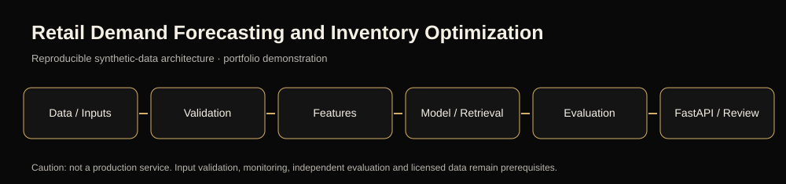
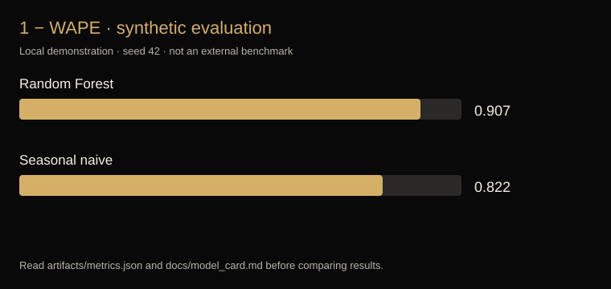

# Retail Demand Forecasting and Inventory Optimization





> **Demonstration only:** Synthetic or bundled sample data; not validated in production and not an authorized real-world decision service.

## Purpose
Retail sales prediction and reorder simulation.

## Features
- Deterministic training pipeline, a baseline model comparison, saved metrics and visual evaluation
- FastAPI endpoints for health and project-appropriate predictions or retrieval
- Automated tests, documentation, Dockerfile and a GitHub Actions testing workflow

## Run locally
```bash
python -m venv .venv
pip install -r requirements.txt
python engine.py train
python -m unittest discover -s tests -v
uvicorn api:app --reload
```

## Results & limitations
See `artifacts/metrics.json` for recorded **synthetic/sample-only** model metrics, `docs/implementation.md` for evaluation logic and `docs/model_card.md` for prohibited uses and open requirements. The generated plot is illustrative evidence of this local model training, not an external benchmark.

## API
- `GET /health`
- `POST /predict` for numeric features
- `GET /search?q=...` for the multilingual search project
- `GET /recommend?user_id=0&k=5` for the recommendation project
- `GET /docs` for interactive OpenAPI documentation.
