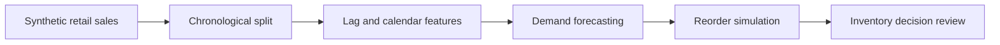

# End-to-end workflow — Retail Demand Forecasting and Inventory Optimization

## How to reproduce

1. Run `python engine.py train`. The project generates or loads its **synthetic/bundled demonstration** input, creates its model, and writes local metrics and PNG graphs.
2. Run `python -m unittest discover -s tests -v` to execute the smoke tests.
3. Run `uvicorn api:app --reload`; inspect `/health` and the appropriate route in `/docs`.
4. Read `docs/model_card.md` for limitations, dataset provenance, uncertainty and restrictions.

## Deployment boundaries

This pipeline is a **research/portfolio simulation**. No claim is made of production authentication, real customer datasets, live data ingestion, validated healthcare/credit outcomes, or public cloud hosting. Where domain decisions matter, predictions must be independently evaluated and reviewed by qualified humans.
